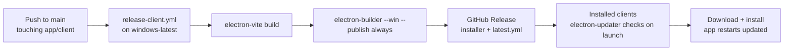

# Tailwind CSS in an Electron (electron-vite) App

This document covers:

1. How Tailwind CSS is set up and used in our Electron desktop client (`app/client`).
2. How the project was scaffolded with `npm create @quick-start/electron`.
3. What changes you must make when turning the scaffold into **your own repo** — GitHub
   ownership fields, auto-update config, and CI/CD.

Everything below reflects the actual configuration in this repository.

---

## 1. Scaffolding the project

The client was bootstrapped with the official electron-vite scaffold
(`@quick-start/electron`, maintained by the electron-vite team):

```bash
# npm
npm create @quick-start/electron@latest

# pnpm
pnpm create @quick-start/electron
```

The interactive prompt asks for:

- **Project name** → `wcl`
- **Select a framework** → `React` (Vue/Svelte/Vanilla also available)
- **Add TypeScript?** → `Yes`
- **Add Electron updater plugin?** → `Yes` (installs `electron-updater` and generates
  `dev-app-update.yml`)
- **Enable Electron download mirror proxy?** → `No` (only needed behind certain
  corporate networks / in some regions)

This produces the standard three-process electron-vite layout:

```
app/client/
├── electron.vite.config.ts     # one config for main + preload + renderer
├── electron-builder.yml        # packaging / publishing config
├── dev-app-update.yml          # auto-update feed used in DEV only
├── tsconfig.node.json          # for main + preload (Node context)
├── tsconfig.web.json           # for renderer (browser context)
└── src/
    ├── main/                   # Electron main process
    ├── preload/                # contextBridge scripts
    └── renderer/
        ├── src/
        │   ├── assets/
        │   ├── styles/globals.css   # Tailwind entry point
        │   └── ...
        └── index.html
```

> **Note on package managers.** The scaffold defaults to npm, but this repo uses
> **Bun** everywhere (`bun install`, `bun run build`, Bun in CI). The `postinstall`
> script was adjusted accordingly: `"postinstall": "bun node_modules/electron/install.js && electron-builder install-app-deps"`.

---

## 2. Tailwind CSS v4 integration

We use **Tailwind CSS v4**, which is a very different setup from v3: there is no
`postcss.config` and no required `content` array. Tailwind v4 runs as a **native Vite
plugin** and discovers classes automatically.

### 2.1 Install

```bash
bun add tailwindcss @tailwindcss/vite
```

That's the entire dependency list — no `postcss`, no `autoprefixer` (v4 handles
vendor prefixing itself).

### 2.2 Register the plugin in `electron.vite.config.ts`

The key point for Electron: the plugin goes **only in the `renderer` section**. The
`main` and `preload` processes are Node contexts — Tailwind has nothing to do there.

```ts
import tailwindcss from '@tailwindcss/vite'
import react from '@vitejs/plugin-react'
import { defineConfig, externalizeDepsPlugin } from 'electron-vite'
import { resolve } from 'path'

export default defineConfig({
  main: {
    plugins: [externalizeDepsPlugin()]
  },
  preload: {
    plugins: [externalizeDepsPlugin()]
  },
  renderer: {
    resolve: {
      alias: {
        '@renderer': resolve('src/renderer/src')
      }
    },
    plugins: [react(), tailwindcss()]
  }
})
```

### 2.3 The CSS entry point — `src/renderer/src/styles/globals.css`

Tailwind v4 is configured **in CSS**, not in JS. Our entry file starts with:

```css
@import 'tailwindcss';

/* Dark mode is class-based (`.dark` on <html>), not media-query based,
   so users can toggle theme inside the app. */
@custom-variant dark (&:is(.dark *));

/* App font bundled locally — a desktop app must not depend on Google Fonts
   at runtime (offline kiosks!). */
@font-face {
  font-family: 'Inter';
  src: url('../assets/fonts/Inter.ttf') format('truetype');
  font-weight: 100 900;
  font-style: normal;
  font-display: swap;
}
```

Then we define the full shadcn/ui-style design-token system as CSS variables
(`--background`, `--foreground`, `--primary`, `--border`, `--sidebar-*`, chart colors,
etc.) in `:root` and `.dark`, using `oklch()` colors. A `@theme inline` block maps
those variables onto Tailwind utilities (`bg-background`, `text-foreground`,
`border-border`, …).

**Electron-specific reasoning:**

- **Local fonts, not CDN fonts.** Exam-hall clients run offline; every asset must ship
  inside the app.
- **Class-based dark mode.** The main process can flip a `.dark` class on the window
  without restarting or respecting the OS theme.

### 2.4 The `tailwind.config.ts` file

With v4, a JS/TS config is **optional**. We keep a minimal one only for editor
tooling / any plugin that still reads it:

```ts
import type { Config } from 'tailwindcss'

export default {
  theme: {
    extend: {
      fontFamily: {
        sans: ['Inter', 'sans-serif']
      }
    }
  }
} satisfies Config
```

All real theming lives in `globals.css`. If you're starting fresh with v4, you can
delete this file entirely.

### 2.5 Importing the CSS in the renderer

`src/renderer/src/main.tsx` (or `App.tsx`) imports the stylesheet once:

```tsx
import './styles/globals.css'
```

### 2.6 `cn()` helper for class merging

For component libraries (we use shadcn/ui-style components with Radix + CVA), the
standard `cn` utility lives in `src/renderer/src/lib/utils.tsx`:

```ts
import { clsx, type ClassValue } from 'clsx'
import { twMerge } from 'tailwind-merge'

export function cn(...inputs: ClassValue[]) {
  return twMerge(clsx(...inputs))
}
```

Dependencies: `clsx`, `tailwind-merge`, `class-variance-authority`, `lucide-react`
(icons), `radix-ui`.

### 2.7 What's different vs. a plain web app

| Concern | Web app (Next.js/Vite) | Electron (electron-vite) |
| --- | --- | --- |
| Plugin placement | Single Vite config | **`renderer` block only** of `electron.vite.config.ts` |
| Fonts | Google Fonts CDN is fine | Must be bundled locally (offline) |
| Dark mode | Often media-query | Class-based, toggled from main process |
| CSS delivery | Server/CDN | Bundled into `out/renderer/assets/*.css`, loaded via `file://` (prod) or dev server (dev) |
| `postcss.config` | Needed for v3 | **Not needed** with v4's Vite plugin |

---

## 3. Making it *your* repo — GitHub, ownership, and CI/CD

The scaffold ships with placeholder metadata pointing at the electron-vite template.
Before this is a real project with working auto-updates and CI, you must change
several files. Here is every change we made.

### 3.1 `package.json` — identity fields

```json
{
  "name": "wcl",
  "productName": "WCL",
  "version": "1.0.0",
  "author": "Bhuvnesh Verma (https://github.com/MasterBhuvnesh)",
  "contributors": ["Vivian Demello (https://github.com/vynride)"],
  "homepage": "https://github.com/MasterBhuvnesh/WCL",
  "repository": {
    "type": "git",
    "url": "git+https://github.com/MasterBhuvnesh/WCL.git",
    "directory": "app/client"
  }
}
```

- `name` must be lowercase, no spaces — it becomes the artifact filename.
- `repository` matters because `electron-updater` can fall back to it to locate
  releases.
- `directory` is needed in a **monorepo** where the client is not at the repo root
  (ours lives in `app/client`).

### 3.2 `electron-builder.yml` — publish target

This is the file that decides **where releases are uploaded**:

```yaml
appId: in.wcl.desktop
productName: WCL
publish:
  owner: MasterBhuvnesh
  repo: WCL
  provider: github
  releaseType: release      # NOT draft — see below
  updaterCacheDirName: wcl-updater
```

Hard-won gotchas baked into our config:

- **`releaseType: release`, not `draft`.** Draft releases are invisible to
  `electron-updater` — installed clients would never see updates.
- **Do NOT set `publisherName` on unsigned builds.** If set, `electron-updater`
  verifies the downloaded installer's Authenticode signature against it. On an
  unsigned build (`signerCertificate: null`) that check always fails and **every
  auto-update aborts**. Only add it once you sign installers with a code-signing cert.
- `appId` should be a reverse-domain identifier you control; it's permanent once
  users install.

### 3.3 `dev-app-update.yml` — dev-only update feed

```yaml
owner: MasterBhuvnesh
repo: WCL
provider: github
repository: 'https://github.com/MasterBhuvnesh/WCL'
updaterCacheDirName: wcl-updater
branch: main
releaseType: release
private: false
```

This file is only read when running `electron-vite dev`. It must mirror the real
`publish` config or dev-mode update checks fail confusingly.

### 3.4 CI — `.github/workflows/ci.yml`

The client job in our monorepo CI:

```yaml
client:
  runs-on: ubuntu-latest
  defaults:
    run:
      working-directory: app/client
  # electron-vite build compiles only; it never launches Electron, so we skip
  # the ~100MB binary download in postinstall.
  env:
    ELECTRON_SKIP_BINARY_DOWNLOAD: "1"
  steps:
    - uses: actions/checkout@v4
    - uses: oven-sh/setup-bun@v2
      with:
        bun-version: "1.3.8"
    - run: bun install --frozen-lockfile
    - run: bun run validate   # format + lint + typecheck
    - run: bun run build      # typecheck + electron-vite build
```

Key points:

- **`ELECTRON_SKIP_BINARY_DOWNLOAD: "1"`** — CI only compiles, it never opens a
  window. Skipping the Electron binary download cuts minutes off every run.
- `working-directory` because of the monorepo layout.
- The scaffold's `validate` script (prettier + eslint + dual tsconfig typecheck) is
  kept as the quality gate.

### 3.5 Release pipeline — `.github/workflows/release-client.yml`

Every push to `main` that touches client code publishes a Windows installer to
GitHub Releases, and installed clients auto-update on next launch:

```yaml
name: Release Client
on:
  push:
    branches: [main]
    paths:
      - 'app/client/src/**'
      - 'app/client/resources/**'
      - 'app/client/build/**'
      - 'app/client/package.json'
      - 'app/client/electron-builder.yml'
      - 'app/client/electron.vite.config.ts'
      - '.github/workflows/release-client.yml'
  workflow_dispatch:

concurrency:
  group: release-client-${{ github.ref }}
  cancel-in-progress: true

jobs:
  release:
    runs-on: windows-latest        # must match the target OS of the build
    defaults:
      run:
        working-directory: app/client
    permissions:
      contents: write              # electron-builder needs this to create the Release
    steps:
      - uses: actions/checkout@v4
      - uses: oven-sh/setup-bun@v2
        with:
          bun-version: "1.3.8"
      - run: bun install --frozen-lockfile

      # Monotonic version from the run number; NOT committed back to the repo,
      # which avoids a CI loop (bump → release → bump → …).
      - name: Set build version
        run: npm version "1.0.${{ github.run_number }}" --no-git-tag-version --allow-same-version

      - run: bun run build
        env:
          VITE_API_BASE: ${{ vars.VITE_API_BASE || 'https://api.rbuexam.in' }}

      - name: Build and publish Windows installer
        run: bunx electron-builder --win --publish always
        env:
          GH_TOKEN: ${{ secrets.GITHUB_TOKEN }}
```

What to adapt for your repo:

| Item | Why |
| --- | --- |
| `owner` / `repo` in `electron-builder.yml` + `dev-app-update.yml` | Where releases are published and where updaters look |
| `paths:` filter | A docs-only edit must not ship an update to every installed device |
| `permissions: contents: write` | `GITHUB_TOKEN` must be allowed to create Releases |
| `runs-on: windows-latest` | Windows installers must be built on Windows (same for mac/linux) |
| `GH_TOKEN: secrets.GITHUB_TOKEN` | Built-in token — no personal PAT needed for public repos |
| Version strategy | `github.run_number` gives strictly increasing versions without commit-back loops |
| `VITE_API_BASE` | Env vars prefixed `VITE_` are baked into the renderer bundle at build time |

### 3.6 Auto-update flow (end to end)



`electron-updater` reads `latest.yml` from the Release assets to decide whether an
update exists — which is why `releaseType: release` and correct `owner`/`repo` are
non-negotiable.

---

## 4. Quick checklist when cloning this setup to a new project

- [ ] Scaffold with `npm create @quick-start/electron@latest` (or `pnpm create @quick-start/electron`)
- [ ] `bun add tailwindcss @tailwindcss/vite` (v4 — no PostCSS config needed)
- [ ] Add `tailwindcss()` to the **renderer** block of `electron.vite.config.ts` only
- [ ] `@import 'tailwindcss'` + `@custom-variant dark` in the renderer CSS entry
- [ ] Bundle fonts locally under `src/renderer/src/assets/fonts/`
- [ ] Update `package.json`: `name`, `productName`, `author`, `homepage`, `repository` (+ `directory` in monorepos)
- [ ] Update `electron-builder.yml`: `appId`, `productName`, `publish.owner`, `publish.repo`, `releaseType: release`
- [ ] Mirror the same owner/repo in `dev-app-update.yml`
- [ ] Do **not** set `publisherName` unless installers are code-signed
- [ ] CI job: set `ELECTRON_SKIP_BINARY_DOWNLOAD: "1"`, run `validate` + `build`
- [ ] Release job: `runs-on` matching target OS, `permissions: contents: write`, `GH_TOKEN: secrets.GITHUB_TOKEN`, `--publish always`
- [ ] Add a `paths:` filter so docs changes don't trigger releases
